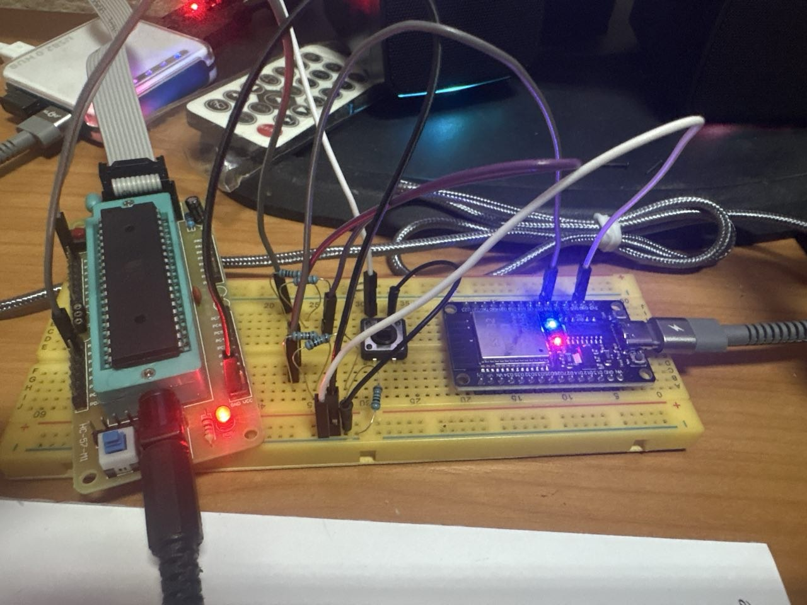
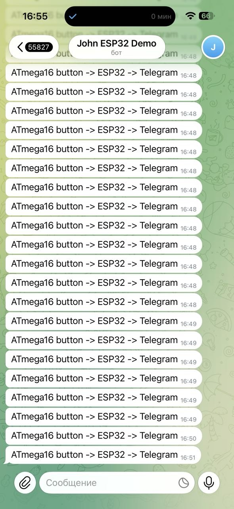

# ATmega16 → ESP32 → Telegram
Button on **ATmega16** → UART → **ESP32** → message in **Telegram**.
[button] → ATmega16 ──UART 9600──→ ESP32 ──Wi‑Fi──→ Telegram

## Demo

## Files
| File | Role |
|------|------|
| `atmega16_uart_btn.ino` | ATmega16: button → `BTN` on Serial 9600 |
| `esp32_uart_bridge.ino` | ESP32: Serial2 (GPIO16) → Telegram |
## Hardware
- ATmega16 on HC-57 + USBasp
- ESP32 DevKit
- Button on PB0, common GND
- TX (PD1) → resistor divider 5 V→3.3 V → ESP32 **GPIO16**
## Flash
1. **ATmega16** (MightyCore): Clock **Internal 8 MHz**, Programmer USBasp → *Upload Using Programmer*
2. **ESP32**: create `secrets.h` next to the sketch (Wi‑Fi + bot token + chat id), board **ESP32 Dev Module** → Upload
3. Press button → Telegram: `ATmega16 button -> ESP32 -> Telegram`
